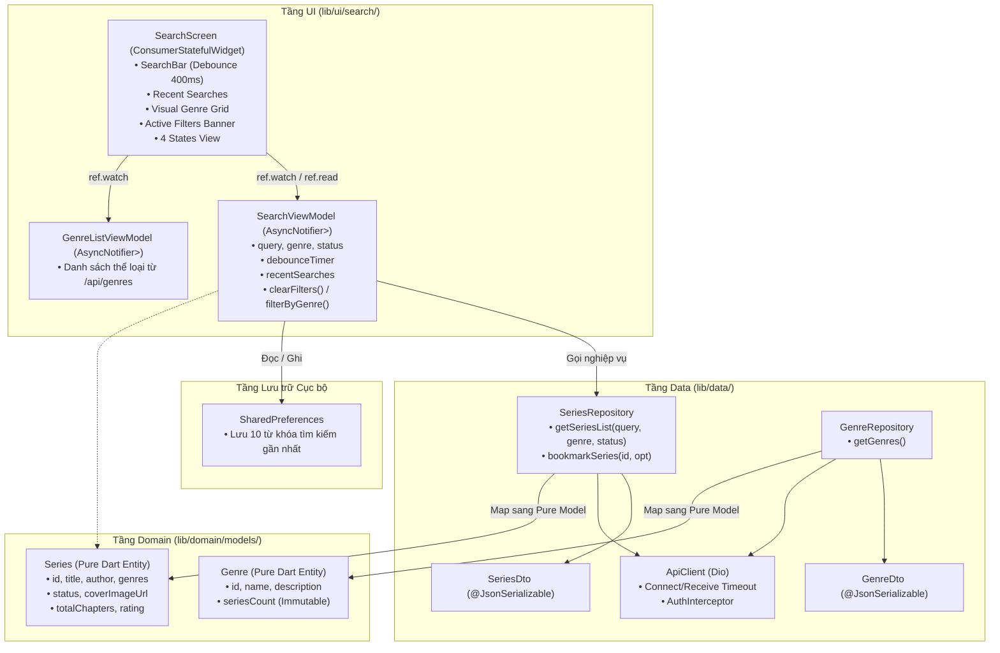

# TÀI LIỆU PHÂN TÍCH & ĐẶC TẢ KIẾN TRÚC: TÁCH TÍNH NĂNG TÌM KIẾM & BỘ LỌC THỂ LOẠI THÀNH TRANG MỚI CÓ NAVBAR RIÊNG
### Dự án: JoyleeBook Mobile (Flutter — PRN232)
### Người lập: Antigravity
### Tài liệu quy chiếu: `CHECKLIST_CODE_REVIEW.md`, `CHECKLIST_RESEARCH_GENRES.md`, `docs/01-System-Scope-Reader.md`, `docs/02-Mobile-Architecture.md`, `docs/03-System-Flows-And-Contracts.md`, `docs/Flutter-Mobile-Code-Rules.md`, `docs/Design-System.md`, `CLAUDE.md`

---

## 🧭 TỔNG QUAN & BỐI CẢNH DỰ ÁN

### 1. Hiện trạng triển khai (As-Is State)
- Hiện tại, chức năng **Tìm kiếm (Search with Debounce 400ms)** và **Bộ lọc Thể loại (Genre Filter Bar & Genre Bottom Sheet)** đang được tích hợp trực tiếp vào màn hình **Kho Truyện** (`SeriesListScreen` tại file `lib/ui/series/widgets/series_list_screen.dart`).
- Trên thanh điều hướng đáy (`AppShell` — `NavigationBar` Material 3), tab 0 là "Kho Truyện", gánh cả hai vai trò:
  1. **Trang chủ duyệt truyện (Home Feed)**: Hiển thị toàn bộ tác phẩm trên hệ thống.
  2. **Công cụ tra cứu & lọc chuyên sâu (Search & Discovery Tool)**: Thanh tìm kiếm chiếm 118dp `PreferredSize` của `AppBar`, thanh chip cuộn ngang, modal bottom sheet thể loại, banner filter tags, logic đồng bộ từ khóa và debounce.

### 2. Vấn đề & Lý do cần tách thành trang mới (Problem & Rationale)
1. **Vi phạm Nguyên tắc Đơn trách nhiệm (Single Responsibility Principle - SRP)**:
   - `SeriesListScreen` hiện bị phình to (>347 dòng code), vừa quản lý hiển thị danh sách trang chủ, vừa quản lý trạng thái search bar, focus bàn phím ảo, chip thể loại cuộn ngang, modal lọc nâng cao và các banner trạng thái lọc.
2. **Trải nghiệm người dùng (UX) bị giới hạn**:
   - Màn hình trang chủ bị chiếm diện tích lớn bởi thanh Search và Chip thể loại ngay trên AppBar, làm giảm không gian hiển thị bìa truyện và giảm phong cách thư thái ấm áp (**Warm Editorial**).
   - Độc giả không có một "Trung tâm Khám phá" (Search & Explore Hub) thực thụ: thiếu tính năng xem **lịch sử tìm kiếm gần đây (Recent Searches)**, thiếu **gợi ý từ khóa hot**, và thiếu **lưới danh mục thể loại trực quan (Category Visual Grid)** kèm số lượng tác phẩm.
3. **Tiêu chuẩn Barem PRN232 (15% Architecture - 15% UI/UX - 50% Business Logic)**:
   - Việc tách riêng một trang **"Khám phá & Tìm kiếm"** (Explore / Search Page) với icon thanh điều hướng (NavigationBar Item) độc lập sẽ giúp cấu trúc module rõ ràng theo chuẩn **Compass App Feature-First**, dễ dàng viết Unit/Widget Tests độc lập và đáp ứng trọn vẹn barem điểm cao nhất của đồ án.

---

## 🏛️ ĐẶC TẢ KIẾN TRÚC PHÂN TẦNG (COMPASS APP ARCHITECTURE — 15% ĐIỂM)

Mô hình kiến trúc Compass App cho tính năng Tìm kiếm & Bộ lọc độc lập được tổ chức như sau:

```
Widget (SearchScreen) ──► ViewModel (SearchViewModel) ──► Repository (SeriesRepo & GenreRepo) ──► Gateway
     ▲                              │                                    │
     └──────────────────────────────┴────── Pure Domain Models ◄─────────┴── DTOs (Safe Parsing)
```



### 1. Tầng Data (Data Layer)
- **DTOs (`lib/data/dtos/`)**:
  - `GenreDto` (`genre_dto.dart`): Parse JSON an toàn từ `GET /api/genres` với null-safety tuyệt đối (`as num?` -> `.toInt() ?? 0`), không dùng toán tử ép kiểu cưỡng bức `!`.
  - `SeriesDto` (`series_dto.dart`): Parse JSON danh sách tác phẩm từ `GET /api/series?search=...&genre=...&status=...`.
- **Repositories (`lib/data/repositories/`)**:
  - `GenreRepository`: Đã có phương thức `Future<List<Genre>> getGenres()`, bắt `DioException` và rethrow thành `AppException.fromDio(e)`.
  - `SeriesRepository`: Đã có phương thức `getSeriesList({String? searchQuery, String? genre, SeriesStatus? status})`.
  - **Fakes phục vụ Test**: Giữ vững `FakeGenreRepository` và `FakeSeriesRepository` trong thư mục `testing/fakes/` để kiểm thử widget/unit không phụ thuộc mạng.

### 2. Tầng Domain (Domain Layer)
- **`Genre` (`lib/domain/models/genre.dart`)**:
  - Pure Dart entity, không phụ thuộc Flutter framework (`material.dart`, `dio.dart`, `riverpod`).
  - Toàn bộ trường `final`, có hàm `copyWith()`, override `operator ==` và `hashCode`.
- **`Series` (`lib/domain/models/series.dart`)**:
  - Pure Dart entity đại diện cho tác phẩm.
- **`SearchFilterCriteria` (Model tùy chọn đại diện cho tiêu chí lọc)**:
  ```dart
  @immutable
  class SearchFilterCriteria {
    final String query;
    final String? genre;
    final SeriesStatus? status;
    const SearchFilterCriteria({this.query = '', this.genre, this.status});
    bool get isFiltered => query.isNotEmpty || genre != null || status != null;
  }
  ```

### 3. Tầng UI / Quản lý Trạng thái (UI Layer & State Management)
- **Tách riêng module mới**: `lib/ui/search/`
  ```
  lib/ui/search/
  ├── view_models/
  │   ├── search_view_model.dart          # Quản lý query, debounce, filters, search history
  │   └── search_view_model.provider.dart # Provider đăng ký Riverpod
  └── widgets/
      ├── search_screen.dart              # Màn hình chính Khám phá & Tìm kiếm
      ├── search_bar_header.dart          # Input tìm kiếm chuyên dụng với nút xóa
      ├── search_recent_keywords.dart     # Chip hiển thị lịch sử tìm kiếm gần nhất
      ├── search_genre_grid.dart          # Lưới khám phá thể loại trực quan
      ├── search_active_filters.dart      # Banner các tiêu chí đang lọc
      └── search_results_list.dart        # Danh sách kết quả (4 States: Loading/Empty/Error/Data)
  ```
- **Tái cấu trúc `SeriesListViewModel` (Kho Truyện cũ)**:
  - Bỏ bớt logic `debounceTimer`, `_currentQuery`, `filterByGenre` khỏi `SeriesListViewModel`.
  - `SeriesListViewModel` trở về vai trò thuần khiết: Tải danh sách truyện trang chủ, hỗ trợ pull-to-refresh và bookmark.
- **Tạo mới `SearchViewModel`**:
  - Kế thừa `AsyncNotifier<List<Series>>`.
  - Quản lý trạng thái: `query`, `selectedGenre`, `selectedStatus`, `recentSearches` (Lịch sử tìm kiếm).
  - Tích hợp Debounce 400ms bằng `Timer`.
  - Tích hợp tự động lưu/xóa lịch sử từ khóa vào `SharedPreferences`.

---

## 🧭 CẤU TRÚC ĐIỀU HƯỚNG & NAVBAR MỚI (ROUTING & APP SHELL)

### 1. Phân tích cấu trúc Thanh điều hướng đáy (Bottom Navigation Bar)

Hiện tại thanh điều hướng gồm 4 tab:
```
[0: Kho Truyện] ── [1: Tủ Sách] ── [2: Cá Nhân] ── [3: Kiểm Tra Gateway]
```

#### Phương án đề xuất tối ưu (Chuẩn UX Mobile App):
Đưa tab **"Tìm kiếm / Khám phá"** vào vị trí thứ 2 (cạnh Trang chủ), giữ tab Gateway hoặc chuyển Gateway vào màn hình Dev Settings:

| Tab Index | Label | Icon (Unselected / Selected) | Path | Trách nhiệm |
| :---: | :--- | :--- | :--- | :--- |
| **0** | **Kho Truyện** | `Icons.auto_stories_outlined` / `auto_stories_rounded` | `/series` | Trang chủ duyệt tác phẩm, danh sách nổi bật, đọc tiếp |
| **1** | **Khám Phá** *(MỚI)* | `Icons.explore_outlined` / `explore_rounded`<br>*(hoặc `Icons.search_rounded`)* | `/explore` *(hoặc `/search`)* | **Tìm kiếm từ khóa (Debounce 400ms), Lọc Thể loại, Trạng thái, Lịch sử tìm kiếm** |
| **2** | **Tủ Sách** | `Icons.bookmarks_outlined` / `bookmarks_rounded` | `/bookmarks` | Tủ sách cá nhân (Yêu thích, Đang đọc dở, Lịch sử) |
| **3** | **Cá Nhân** | `Icons.person_outline` / `person` | `/profile` | Thông tin độc giả, cài đặt giao diện, thống kê đọc |
| **4** *(Dev)* | **Kiểm tra Gateway** | `Icons.router_outlined` / `router_rounded` | `/gateway` | Công cụ chẩn đoán microservices Gateway (PRN232) |

> [!NOTE]
> `NavigationBar` của Material 3 hỗ trợ tối ưu từ 3 đến 5 destinations. Với 5 destinations (Kho Truyện, Khám Phá, Tủ Sách, Cá Nhân, Gateway), thanh điều hướng hoàn toàn vừa vặn, không bị tràn trên màn hình điện thoại thông dụng (>= 360dp width).

### 2. Cập nhật `AppPaths` (`lib/routing/app_paths.dart`)
```dart
abstract final class AppPaths {
  // Các tab chính trên NavigationBar
  static const series = '/series';
  static const search = '/search'; // HOẶC: static const explore = '/explore';
  static const bookmarks = '/bookmarks';
  static const profile = '/profile';
  static const gateway = '/gateway';

  // ... các route auth và chi tiết truyện giữ nguyên
}
```

### 3. Cập nhật `AppRouter` (`lib/routing/app_router.dart`)
Bổ sung một `StatefulShellBranch` mới độc lập trong `StatefulShellRoute.indexedStack`:

```dart
// StatefulShellBranch cho Tab Khám Phá & Tìm Kiếm
StatefulShellBranch(
  routes: [
    GoRoute(
      path: AppPaths.search,
      builder: (context, state) {
        // Nhận tham số genre từ query parameter nếu có (khi navigate từ SeriesDetailScreen)
        final initialGenre = state.uri.queryParameters['genre'];
        return SearchScreen(initialGenre: initialGenre);
      },
      routes: [
        // Hỗ trợ xem chi tiết truyện trực tiếp ngay từ kết quả tìm kiếm
        GoRoute(
          path: ':seriesId',
          builder: (context, state) => SeriesDetailScreen(
            seriesId: state.pathParameters['seriesId']!,
            initialSeries: state.extra as Series?,
          ),
        ),
      ],
    ),
  ],
),
```

### 4. Tương tác điều hướng chéo từ `SeriesDetailScreen`
Trong file `lib/ui/series/widgets/series_detail_screen.dart` (dòng 712–718), khi độc giả bấm vào Tag Thể loại:
- **Trước đây**: Gọi `SeriesListViewModel.filterByGenre(genre)` rồi chuyển hướng về `context.go(AppPaths.series)`.
- **Mới**: Gọi `SearchViewModel.filterByGenre(genre)` và chuyển hướng sang tab Tìm kiếm:
  ```dart
  onTap: () {
    ref.read(searchViewModelProvider.notifier).filterByGenre(genre);
    context.go('${AppPaths.search}?genre=${Uri.encodeComponent(genre)}');
  }
  ```

---

## 🎨 THIẾT KẾ UI/UX & QUY CHUẨN WARM EDITORIAL (15% ĐIỂM)

Màn hình mới `SearchScreen` được thiết kế theo đúng phong cách **Warm Editorial** và tuân thủ các quy chuẩn nghiêm ngặt:

### 1. Cấu trúc Layout 2 Chế độ (Two-mode Dynamic Layout)

```
┌────────────────────────────────────────────────────────┐
│ AppBar: JoyleeSearchBar (Debounce 400ms + Clear icon)  │
├────────────────────────────────────────────────────────┤
│ Khi CHƯA nhập từ khóa & CHƯA chọn lọc (Khám Phá):      │
│  1. Từ khóa gần đây (Recent Searches chips + Clear)   │
│  2. Khám phá theo Thể loại (Lưới 2-3 cột kèm số lượng) │
│  3. Gợi ý tác phẩm đọc nhiều (Trending Cards)          │
├────────────────────────────────────────────────────────┤
│ Khi ĐÃ nhập từ khóa HOẶC ĐÃ chọn thể loại/bộ lọc:      │
│  1. Horizontal GenreFilterBar (Cuộn nhanh thể loại)    │
│  2. Banner Bộ lọc đang chọn (Active Filter Chips)      │
│  3. Kết quả tìm kiếm (Tuân thủ 4 Trạng thái)           │
└────────────────────────────────────────────────────────┘
```

### 2. Quy chuẩn 4 Trạng thái bắt buộc (4 States Pattern)

1. **Loading State**:
   - Khi đang debounce 400ms hoặc gửi request tìm kiếm lên Gateway: Hiển thị hiệu ứng tải mượt mà.
   - Thể loại hiển thị Skeleton shimmer hoặc indicator xoay tròn màu `colors.primaryBrand` canh giữa màn hình kèm chữ *"Đang tìm kiếm tác phẩm..."*.
2. **Empty State (`JoyleeEmptyState`)**:
   - Khi không tìm thấy kết quả nào khớp với từ khóa/thể loại đã chọn:
     - Icon: `Icons.search_off_rounded`.
     - Tiêu đề: *"Không tìm thấy kết quả phù hợp"*.
     - Mô tả: Hiển thị rõ từ khóa hoặc thể loại đang tìm: *"Không có tác phẩm nào khớp với từ khóa \"{query}\" hoặc thể loại \"{genre}\""*.
     - Nút hành động: **"Xóa bộ lọc"** hoặc **"Khám phá tất cả"** để reset về trạng thái ban đầu.
3. **Error State (`JoyleeErrorView`)**:
   - Khi mất kết nối Internet, máy bay hoặc server 500:
     - Hiển thị thông báo tiếng Việt thân thiện: *"Không thể kết nối đến máy chủ tra cứu. Vui lòng kiểm tra lại mạng."*.
     - Nút hành động: **"Thử lại"** (Retry) gọi trực tiếp `ref.read(searchViewModelProvider.notifier).retry()`.
4. **Data State**:
   - Hiển thị danh sách thẻ truyện (`SeriesCard`) gọn gàng, bọc trong `RefreshIndicator` để hỗ trợ kéo làm mới.

### 3. Quy tắc Chống tràn giao diện & Vùng chạm (Ergonomics)
- **Vùng chạm tối thiểu (Touch Target)**: Mọi chip thể loại, nút xóa, nút mở bộ lọc modal đều đạt diện tích chạm tối thiểu **48x48 dp**.
- **Chống lỗi sọc vàng đen (`RenderFlex overflowed`)**:
  - Dùng `CustomScrollView` hoặc `ListView.builder` kết hợp `SliverList`.
  - Toàn bộ nội dung bọc trong `SafeArea`.
  - Mọi tiêu đề truyện, tên tác giả, tóm tắt có `maxLines: 2` và `overflow: TextOverflow.ellipsis`.
- **Hỗ trợ Light / Dark Mode**: Sử dụng toàn bộ màu sắc từ `context.colors` (`bgCanvas`, `bgSurface`, `textPrimary`, `textSecondary`, `borderDefault`), tuyệt đối không hardcode mã hex `#FFFFFF` hay `#000000`.

---

## ⚖️ LOGIC NGHIỆP VỤ & RÀNG BUỘC DỮ LIỆU (50% TRỌNG SỐ ĐIỂM)

Phần chiếm tỷ trọng điểm cao nhất trong barem đánh giá môn PRN232:

### 1. Ranh giới Quyền hạn Actor Reader (Role Boundary)
- **Tuyệt đối Read-Only đối với danh mục truyện và thể loại**:
  - Ứng dụng chỉ gọi các endpoint đọc dữ liệu: `GET /api/series?search=...`, `GET /api/genres`.
  - Tuyệt đối không xuất hiện các nút tạo thể loại, sửa mô tả thể loại hay tạo truyện (thuộc thẩm quyền Author/Admin trên Web Portal).
  - Không để lộ bất kỳ UI can thiệp dữ liệu quản trị nào trên ứng dụng di động.

### 2. Cơ chế Debounce Tìm kiếm 400ms (Anti-Spam & Rate-Limiting Protection)
- Khi người dùng gõ từng ký tự vào ô tìm kiếm:
  - Huỷ bộ đếm hẹn giờ hiện tại (`_debounceTimer?.cancel()`).
  - Khởi tạo bộ đếm mới thời gian **400ms**.
  - Chỉ khi người dùng ngừng gõ phím trọn vẹn 400ms, request tìm kiếm mới được gửi đến JoyleeBook Gateway.
  - Ngăn ngừa tình trạng spam hàng chục request liên tiếp khi gõ chữ tiếng Việt (bộ gõ Telex/VNI sinh ra nhiều sự kiện thay đổi text trung gian).

### 3. Kiểm soát Biên dữ liệu & Xử lý Ký tự đặc biệt (Boundary Validation)
- **Cắt tỉa khoảng trắng (Trim)**: Tự động loại bỏ khoảng trắng đầu/cuối của từ khóa (`query.trim()`). Nếu chuỗi sau khi trim bị rỗng (`isEmpty`), tự động hủy tìm kiếm từ khóa và hiển thị trạng thái khám phá mặc định.
- **Ký tự đặc biệt & URL Encoding**:
  - Khi gửi query parameter qua Dio, Dio tự động encode URI các ký tự đặc biệt (`&`, `?`, `/`, `#`, `%`, emoji, tiếng Việt có dấu).
  - Giới hạn độ dài từ khóa tìm kiếm tối đa: **100 ký tự** (ngăn chặn người dùng paste văn bản quá dài gây tràn bộ đệm hoặc tấn công DoS).

### 4. Quản lý Lịch sử Tìm kiếm (Search History & Storage Tiers)
- Áp dụng phân tầng lưu trữ chuẩn theo tài liệu kiến trúc:
  - Lịch sử từ khóa tìm kiếm gần đây được lưu trong **`shared_preferences`** dưới dạng mảng JSON string (`List<String>`).
  - **Giới hạn số lượng**: Tối đa **10 từ khóa gần nhất**. Khi thêm từ khóa mới, nếu đã tồn tại thì đưa lên đầu; nếu vượt quá 10 thì tự động loại bỏ từ khóa cũ nhất (FIFO).
  - Cung cấp tính năng: Xóa từng từ khóa lịch sử và "Xóa toàn bộ lịch sử tìm kiếm".

### 5. Cơ chế Cập nhật Lạc quan (Optimistic UI with Rollback) cho Bookmark
- Ngay trên danh sách kết quả tìm kiếm, độc giả có thể bấm lưu truyện vào Tủ sách:
  1. Icon bookmark đổi màu ngay lập tức (`isBookmarked = !isBookmarked`).
  2. Bắn request ngầm `POST /api/library/bookmarks` hoặc `DELETE /api/library/bookmarks/{seriesId}`.
  3. Nếu gặp sự cố mạng hoặc API trả về lỗi: Lập tức **Rollback** trạng thái icon về như cũ và hiển thị thông báo SnackBar tiếng Việt: *"Không thể cập nhật tủ sách. Đã khôi phục trạng thái."*.

---

## 📋 SO SÁNH TRƯỚC VÀ SAU KHI TÁCH TRANG (BEFORE VS. AFTER)

| Tiêu chí | Trước khi tách (Hiện tại) | Sau khi tách (Đề xuất) | Đánh giá lợi ích |
| :--- | :--- | :--- | :--- |
| **Vị trí thanh điều hướng** | Nằm chung trong tab 0 "Kho Truyện". | Có tab riêng **"Khám Phá"** với icon `Icons.explore_outlined` / `Icons.search_rounded`. | Phân định rõ ràng mục đích của từng tab; người dùng tìm kiếm chỉ với 1 chạm. |
| **Giao diện Kho Truyện (Home)** | Bị thu hẹp bởi Search bar (118dp) + Chip thể loại trên AppBar; rối mắt. | Tinh giản, chuẩn Warm Editorial: hiển thị danh mục truyện nổi bật, banner đẹp mắt, đọc tiếp. | Trả lại không gian đọc sách thư thái, thoáng đãng cho trang chủ. |
| **Khả năng tra cứu** | Chỉ có 1 thanh search đơn giản + chip cuộn ngang. | **Trung tâm Khám phá toàn diện**: Search bar chuyên biệt, Lịch sử tìm kiếm gần đây, Lưới thể loại kèm số lượng truyện, Modal lọc trạng thái. | Trải nghiệm tra cứu mạnh mẽ, đúng chuẩn các ứng dụng đọc sách chuyên nghiệp. |
| **Kích thước mã nguồn (Lines of Code)** | `series_list_screen.dart` > 347 dòng, ôm đồm nhiều logic. | Tách nhỏ thành các widget đơn nhiệm: `SearchScreen`, `SearchBarHeader`, `GenreGrid`, mỗi file < 150 dòng. | Dễ bảo trì, tuân thủ Clean Code và Compass App Architecture. |
| **Khả năng kiểm thử (Testability)** | Test search và test home feed bị dính chùm trong `series_list_screen_test.dart`. | Kiểm thử độc lập: `series_list_screen_test.dart` và `search_screen_test.dart`. | Test rõ ràng, không bị phụ thuộc chéo, độ phủ test cao. |

---

## 🛠️ KẾ HOẠCH TRIỂN KHAI TỪNG BƯỚC (STEP-BY-STEP IMPLEMENTATION PLAN)

Kế hoạch chia làm 6 bước bám sát quy trình chuẩn:

### Bước 1: Mở rộng Routing & Cập nhật Navigation Shell
1. Thêm `AppPaths.search = '/search'` vào `lib/routing/app_paths.dart`.
2. Cập nhật `AppShell` (`lib/routing/app_shell.dart`):
   - Bổ sung destination thứ hai:
     ```dart
     NavigationDestination(
       icon: Icon(Icons.explore_outlined),
       selectedIcon: Icon(Icons.explore_rounded),
       label: 'Khám Phá',
     ),
     ```
3. Cập nhật `AppRouter` (`lib/routing/app_router.dart`):
   - Thêm `StatefulShellBranch` thứ hai trỏ đến `SearchScreen`.

### Bước 2: Xây dựng ViewModel cho Tính năng Tìm kiếm (`SearchViewModel`)
1. Tạo file `lib/ui/search/view_models/search_view_model.dart`.
2. Quản lý trạng thái tìm kiếm:
   - Các biến: `_currentQuery`, `_selectedGenre`, `_selectedStatus`, `_recentSearches`.
   - Các phương thức: `search(query)` với Debounce 400ms, `filterByGenre(genre)`, `filterByStatus(status)`, `clearFilters()`, `saveRecentSearch(query)`, `removeRecentSearch(query)`, `clearRecentSearches()`.

### Bước 3: Xây dựng Giao diện Màn hình Tìm kiếm (`SearchScreen` & Widgets)
1. Tạo `lib/ui/search/widgets/search_screen.dart`:
   - `AppBar` chứa `SearchTextField` gọn gàng, có nút clear `X`.
   - `Body`: Khi chưa tìm -> Hiển thị Recent Searches + Genre Visual Grid. Khi đang tìm/đã chọn bộ lọc -> Hiển thị kết quả kèm bộ 4 trạng thái.
2. Tạo `lib/ui/search/widgets/search_genre_grid.dart`:
   - Lưới thể loại bo tròn nhẹ (`radiusMd`), hiển thị tên thể loại và badge số lượng truyện (`seriesCount`).
3. Tái sử dụng `GenreFilterBar` và `GenreBottomSheet` cho chế độ lọc nâng cao.

### Bước 4: Tinh gọn Màn hình Kho Truyện (`SeriesListScreen`)
1. Gỡ bỏ ô search bar và chip thể loại khỏi `AppBar` của `SeriesListScreen`.
2. Thêm một nút icon Kính lúp / Khám phá trên AppBar của `SeriesListScreen` dẫn nhanh sang tab Search: `context.go(AppPaths.search)`.
3. Giữ lại hiển thị danh sách truyện, chế độ kéo làm mới (`RefreshIndicator`) và đổi giao diện Sáng/Tối.

### Bước 5: Cập nhật Điều hướng từ `SeriesDetailScreen`
1. Sửa hàm `_buildGenres` trong `lib/ui/series/widgets/series_detail_screen.dart`:
   - Khi bấm vào tag thể loại, kích hoạt `SearchViewModel.filterByGenre(genre)` và chuyển hướng sang `AppPaths.search`.

### Bước 6: Viết Bộ Test Tự Động (Unit & Widget Tests)
1. Tạo `test/ui/search_view_model_test.dart`:
   - Test debounce 400ms.
   - Test lọc thể loại, lọc trạng thái, xóa bộ lọc.
   - Test lưu và xóa từ khóa lịch sử.
2. Tạo `test/ui/search_screen_test.dart`:
   - Test render search bar, recent keywords, genre grid.
   - Test trạng thái Loading, Empty State, Error State và Data State.
   - Test bấm vào thể loại thì chuyển sang danh sách kết quả.

---

## 🧪 MA TRẬN KIỂM THỬ THỬ THÁCH ĐỘ BỀN (CHAOS & EDGE-CASE TESTING)

Theo Barem Bước 6 của `CHECKLIST_CODE_REVIEW.md`:

| STT | Kịch bản Thử nghiệm | Thao tác thực hiện | Kết quả kỳ vọng đạt chuẩn |
| :-: | :--- | :--- | :--- |
| **1** | **Ngắt kết nối mạng (Offline Test)** | Bật Chế độ máy bay (Airplane mode) rồi gõ từ khóa tìm kiếm hoặc bấm chọn thể loại. | Hiển thị ngay `JoyleeErrorView` tiếng Việt, không bị crash văng app. Bật lại mạng và bấm "Thử lại" thì tải lại bình thường. |
| **2** | **Spam gõ bàn phím (Debounce Test)** | Gõ liên tục thật nhanh một chuỗi dài (ví dụ: *"nang khieu"* gõ 10 ký tự trong 1 giây). | Bộ đếm timer liên tục được reset; chỉ gửi **duy nhất 1 request API** sau khi dừng gõ đủ 400ms. |
| **3** | **Từ khóa biên & Ký tự đặc biệt** | Nhập các ký tự đặc biệt (`@#$%^&*()`, chuỗi toàn dấu cách, chuỗi > 100 ký tự, tiếng Việt có dấu). | Không crash ứng dụng, chuỗi được trim khoảng trắng và mã hóa an toàn qua URI parameters. |
| **4** | **Kết quả rỗng (Empty State)** | Tìm kiếm từ khóa không có thật (`zzzzzzzzz`) hoặc lọc thể loại chưa có truyện. | Hiển thị `JoyleeEmptyState` với thông báo lịch sự tiếng Việt và nút bấm "Xóa bộ lọc" để khôi phục. |
| **5** | **Xoay màn hình / Mở bàn phím ảo** | Mở ô tìm kiếm, bật bàn phím ảo che 50% màn hình, cuộn danh sách kết quả. | Không xuất hiện lỗi dải sọc vàng đen `RenderFlex overflowed`. Bàn phím không che mất các kết quả đầu tiên. |

---

## ✅ BẢNG CHECKLIST NGHIỆM THU DÀNH CHO TEAM LEAD / REVIEWER

Dùng bảng checklist này để đánh giá Pull Request khi triển khai task:

### 1. Kiến trúc Tầng (Compass App Architecture — 15%)
- [ ] Module mới đặt đúng cấu trúc `lib/ui/search/` (chia rõ `view_models/` và `widgets/`).
- [ ] DTO & Domain Model giữ nguyên tính thuần khiết (Pure Dart, Immutable, không import Flutter/Riverpod vào Domain).
- [ ] Repository bọc `try/catch`, bắt `DioException` và rethrow thành `AppException.fromDio(e)`.
- [ ] Có đầy đủ `FakeSeriesRepository` và `FakeGenreRepository` cập nhật trong thư mục test.
- [ ] ViewModel kế thừa `AsyncNotifier<List<Series>>`, quản lý bằng `AsyncValue.guard`.

### 2. Tiêu chuẩn Giao diện (UI/UX & Warm Editorial — 15%)
- [ ] Tab mới hiển thị đúng vị trí trên `NavigationBar` với icon `Icons.explore_outlined` / `explore_rounded`.
- [ ] Đầy đủ bộ **4 trạng thái**: Loading (Skeleton/Shimmer), Empty State (có icon & nút Xóa bộ lọc), Error State (có nút Thử lại), Data State (bọc trong `RefreshIndicator`).
- [ ] Vùng chạm (Touch target) của toàn bộ chip, nút bấm đạt chuẩn tối thiểu **48x48 dp**.
- [ ] Tuyệt đối không xảy ra lỗi sọc vàng đen `RenderFlex overflowed`.
- [ ] Màu sắc tuân thủ Design System (`context.colors`), hỗ trợ đầy đủ cả Light Mode và Dark Mode.

### 3. Logic Nghiệp vụ & Ranh giới (Business Logic & Boundaries — 50%)
- [ ] Phân quyền Reader: Chỉ cho phép đọc (`GET`), tuyệt đối không có thao tác CRUD của Author/Admin.
- [ ] Ô tìm kiếm có cơ chế **Debounce 400ms** chống spam request.
- [ ] Tự động trim khoảng trắng thừa và validate độ dài từ khóa (tối đa 100 ký tự).
- [ ] Lịch sử tìm kiếm lưu trữ an toàn trong `SharedPreferences` (tối đa 10 từ khóa, không trùng lặp).
- [ ] Cơ chế Cập nhật Lạc quan (Optimistic UI) cho nút Bookmark hoạt động mượt mà, tự động rollback khi lỗi mạng.
- [ ] Liên kết chuyển hướng từ Tag thể loại của `SeriesDetailScreen` sang tab Khám phá hoạt động chính xác.

### 4. Quy trình & Tự động hóa (Automated Gates)
- [ ] `flutter analyze`: **No issues found!** (0 errors, 0 warnings).
- [ ] `flutter test`: **100% tests passed** (Bao gồm các test mới cho `SearchScreen` và `SearchViewModel`).
