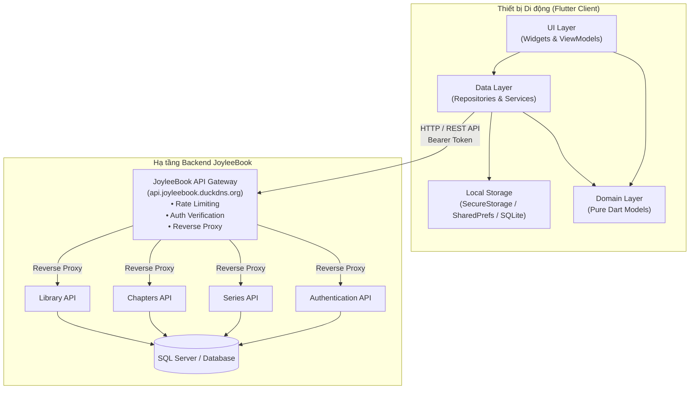
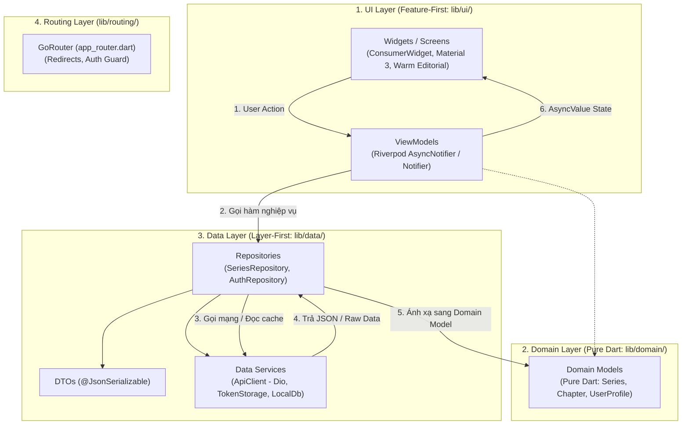
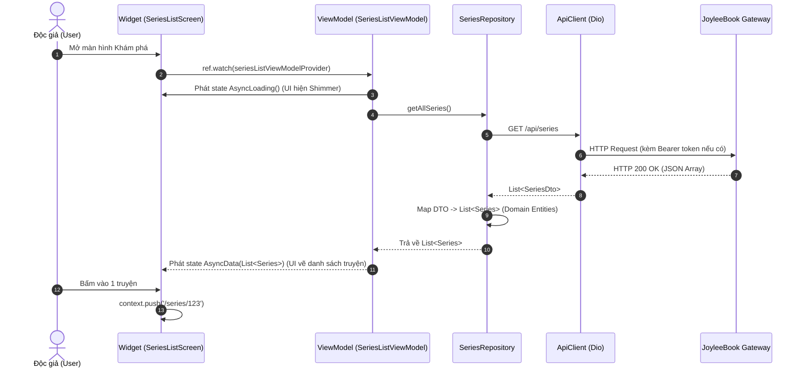
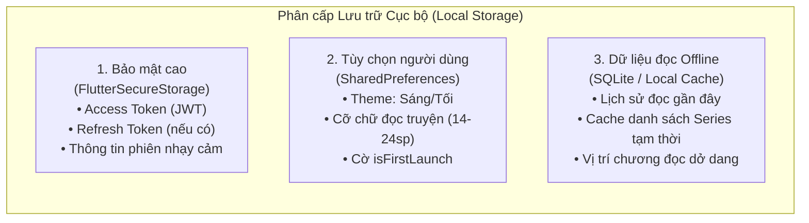

# JoyleeBook Mobile — Kiến trúc Ứng dụng (Mobile Architecture)

Tài liệu này đặc tả chi tiết kiến trúc kỹ thuật của ứng dụng **JoyleeBook Mobile (Flutter)**, được xây dựng theo chuẩn **Compass App Hybrid Architecture** kết hợp hệ sinh thái **Riverpod** và giao tiếp tập trung qua **JoyleeBook API Gateway**.

---

## 1. Sơ đồ Kiến trúc Tổng quan Hệ thống (System Architecture)

Ứng dụng mobile không bao giờ kết nối trực tiếp đến các microservices riêng lẻ hay cơ sở dữ liệu. Mọi tương tác mạng đều đi qua **JoyleeBook Gateway** duy nhất.



---

## 2. Mô hình Kiến trúc Phân tầng (Compass App Hybrid Architecture)

Dự án áp dụng mô hình kết hợp **Hybrid Architecture**:
- **Tầng Data & Domain (Layer-First / By-Type)**: Quản lý tập trung các DTO, Repositories, Domain Models để tái sử dụng xuyên suốt toàn bộ ứng dụng (tránh phụ thuộc chéo giữa các tính năng).
- **Tầng UI (Feature-First)**: Mỗi tính năng của Reader (Auth, Series, Library, Reading, Settings) được đóng gói độc lập gồm `view_models/` và `widgets/`.



---

## 3. Chi tiết Trách nhiệm Từng Tầng (Layer Responsibilities)

### 3.1. Tầng Giao diện (Presentation / UI Layer — `lib/ui/`)
- **`widgets/` (Màn hình & Components)**:
  - Chỉ đảm nhiệm việc vẽ giao diện và lắng nghe tương tác người dùng.
  - Sử dụng `ConsumerWidget` để lắng nghe (`ref.watch()`) trạng thái từ ViewModel.
  - Tuyệt đối không chứa logic gọi API, không parse JSON, không can thiệp trực tiếp vào database.
  - Xử lý trọn vẹn **4 trạng thái (4 States Pattern)**: `Loading` (Shimmer/Spinner), `Empty` (Trống), `Error` (Có nút Retry), `Data` (Dữ liệu hiển thị).
- **`view_models/` (Quản lý State & Logic màn hình)**:
  - Kế thừa `AsyncNotifier<T>` hoặc `Notifier<T>` của Riverpod.
  - Nhận input từ UI, gọi Repositories để lấy dữ liệu, xử lý state biến đổi (`AsyncValue.guard()`).
  - Đảm bảo cơ chế chống spam (Double-click prevention): đặt cờ `isLoading = true` khi đang gửi request.
  - Cung cấp dữ liệu đã qua sàng lọc để UI chỉ việc hiển thị.
- **`ui/core/` (Hạ tầng giao diện dùng chung)**:
  - `themes/`: Cấu hình màu sắc `AppColors`, kích thước `AppDimensions`, phông chữ `AppTheme` theo chuẩn Warm Editorial.
  - `widgets/`: Các Shared Widgets đạt chuẩn (ví dụ: `JoyleeButton`, `JoyleeTextField`, `JoyleeEmptyState`, `JoyleeErrorView`, `JoyleeConfirmDialog`).

### 3.2. Tầng Nghiệp vụ Thuần (Domain Layer — `lib/domain/`)
- Chứa các thực thể nghiệp vụ cốt lõi (**Pure Dart Entities / Models**): `Series`, `Chapter`, `UserProfile`, `ReaderSettings`.
- **Độc lập 100%**: Không import bất kỳ thư viện nào từ `flutter/material.dart`, `dio`, `sqflite` hay `riverpod`.
- Dữ liệu là bất biến (`immutable`), chỉ chứa các trường cần thiết phục vụ logic của app, có phương thức kiểm tra hợp lệ nghiệp vụ (nếu có).

### 3.3. Tầng Dữ liệu (Data Layer — `lib/data/`)
- **`dtos/` (Data Transfer Objects)**:
  - Cấu trúc dữ liệu ánh xạ trực tiếp từ JSON API của Backend Gateway.
  - Tự động hóa serialize/deserialize bằng `@JsonSerializable()`.
  - Chịu trách nhiệm xử lý các trường hợp dữ liệu backend gửi về null, định dạng ngày tháng ISO 8601, enum số.
- **`repositories/` (Kho lưu trữ dữ liệu)**:
  - Đóng vai trò lớp đệm (Abstraction) giữa UI và nguồn dữ liệu thực tế (Remote API hoặc Local Cache).
  - Nhận DTO từ API Service, kiểm tra và chuyển đổi (mapping) thành Domain Model thuần túy trả cho ViewModel.
  - Quyết định chiến lược lấy dữ liệu: ưu tiên mạng trước hay lấy cache trước (Cache-then-Network).
- **`services/` (Dịch vụ hạ tầng thấp tầng)**:
  - `api_client.dart`: Cấu hình `Dio` singleton/instance với timeout (10s connect, 20s receive), logging và interceptors.
  - `token_storage.dart`: Đọc/ghi JWT token an toàn trong Keychain (iOS) hoặc Keystore (Android).
  - `local_storage_service.dart`: Đọc/ghi cài đặt người dùng, lịch sử đọc truyện dở dang.

### 3.4. Tầng Điều hướng (Routing Layer — `lib/routing/`)
- Sử dụng **`GoRouter`** để quản lý điều hướng tập trung theo URL path (ví dụ: `/home`, `/series/:id`, `/reading/:chapterId`, `/sign-in`).
- **Auth Guard & Redirect**: Tự động chuyển hướng người dùng dựa theo trạng thái đăng nhập.
  - Nếu token không tồn tại và người dùng cố truy cập trang riêng tư -> Đẩy về `/sign-in`.
  - Nếu đã đăng nhập mà người dùng mở lại trang `/sign-in` -> Tự động chuyển thẳng vào `/home`.

---

## 4. Luồng Dữ liệu Một chiều (Unidirectional Data Flow - UDF)

Dữ liệu trong ứng dụng JoyleeBook Mobile luôn di chuyển theo một chiều khép kín, đảm bảo trạng thái ứng dụng luôn dự đoán được và dễ kiểm thử:



---

## 5. Chiến lược Lưu trữ Cục bộ (Local Storage Architecture)

Để đảm bảo bảo mật và hỗ trợ trải nghiệm đọc khi mất mạng, ứng dụng chia dữ liệu cục bộ thành 3 cấp độ:



1. **`FlutterSecureStorage` (Cấp 1 — Nhạy cảm)**:
   - Dùng Keychain (iOS) và Android Keystore / EncryptedSharedPreferences (Android).
   - Tuyệt đối không lưu token dạng plain text trong `SharedPreferences`.
2. **`SharedPreferences` (Cấp 2 — Cài đặt nhẹ)**:
   - Lưu trữ cặp key-value cho các thiết lập giao diện của Reader.
   - Truy xuất nhanh đồng bộ trong RAM.
3. **`sqflite` hoặc In-memory / File Cache (Cấp 3 — Dữ liệu truyện)**:
   - Lưu trữ danh sách các tác phẩm đọc gần đây để người đọc tiếp tục đọc ngay cả khi mất mạng.
   - Tự động dọn dẹp các bản ghi quá cũ (FIFO - First In First Out, giữ tối đa 50 chương gần nhất).

---

## 6. Mô hình Quản lý Lỗi (Exception Handling & Error Envelope)

Hệ thống phân cấp lỗi rõ ràng từ tầng Data lên UI, đảm bảo người dùng **không bao giờ nhìn thấy mã lỗi kỹ thuật thô**:

```text
Exception
└── AppException (Trừu tượng)
    ├── NetworkException (Mất mạng, DNS lỗi, ngắt kết nối)
    ├── TimeoutException (Quá hạn 10s kết nối hoặc 20s nhận dữ liệu)
    ├── UnauthorizedException (401 - Hết phiên đăng nhập)
    ├── ForbiddenException (403 - Không có quyền)
    ├── NotFoundException (404 - Dữ liệu không tồn tại)
    ├── ValidationException (400 - Dữ liệu không hợp lệ kèm chi tiết lỗi)
    └── ServerException (500, 502, 503 - Máy chủ bận/lỗi gateway)
```

- **Quy tắc xử lý**:
  - `ApiClient`: Bắt `DioException` và chuyển đổi (mapping) thành `AppException`.
  - `ViewModel`: Dùng `AsyncValue.guard()` để bọc các tác vụ gọi Repository.
  - `UI Screen`: Dùng hàm mở rộng `context.toUserFriendlyMessage(error)` để hiển thị câu tiếng Việt tương ứng trên `JoyleeErrorView` hoặc `SnackBar`.
