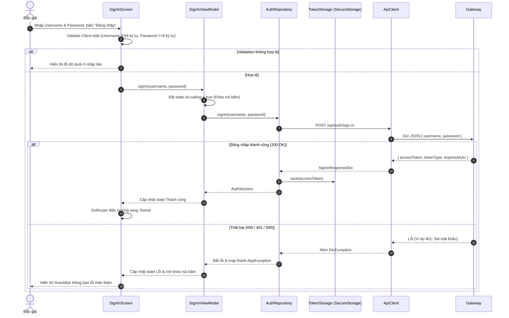
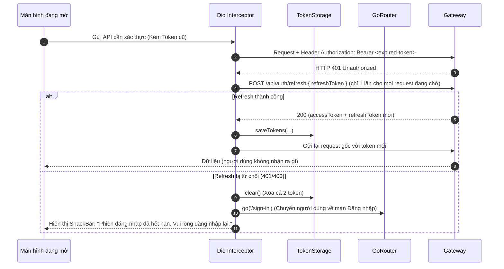
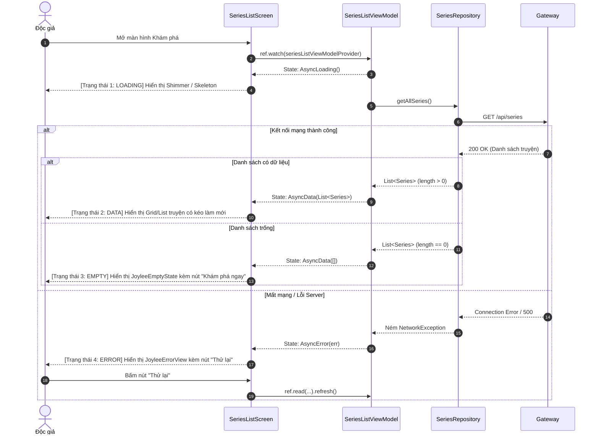
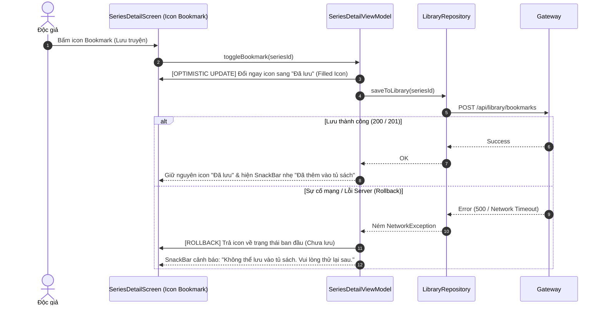
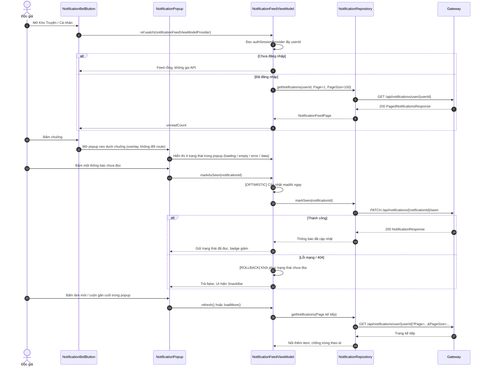
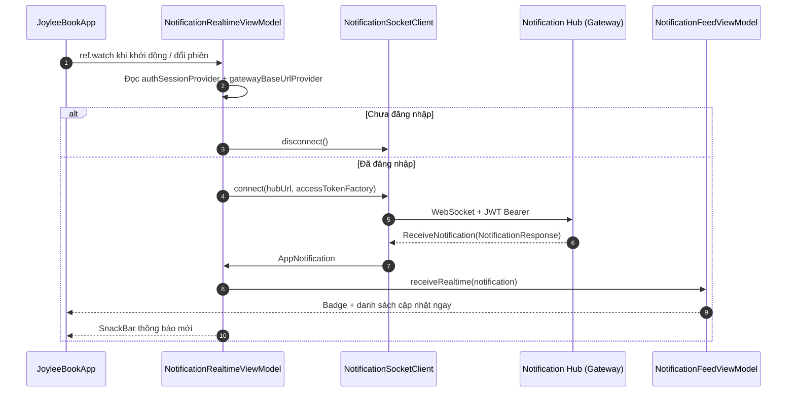

# JoyleeBook Mobile — Luồng Nghiệp vụ & Hợp đồng API (Flows & API Contracts)

Tài liệu này mô tả chi tiết các luồng tương tác của **Độc giả (Reader)** trên ứng dụng di động, kết hợp với bảng đặc tả hợp đồng dữ liệu (API Contracts) qua **JoyleeBook API Gateway** (`https://api.joyleebook.duckdns.org`).

---

## 1. Luồng Xác thực & Quản lý Phiên (Authentication & Session Lifecycle)

Luồng xác thực đảm bảo bảo vệ dữ liệu cá nhân của độc giả, duy trì phiên an toàn và xử lý chuyển tiếp mượt mà khi phiên làm việc hết hạn.

### 1.1. Sơ đồ tuần tự Đăng nhập (Sign In Flow)



### 1.2. Sơ đồ xử lý Token hết hạn (401 Unauthorized Interceptor Flow)

Khi phiên đăng nhập của người dùng hết hạn trong lúc đang sử dụng app:



> [!IMPORTANT]
> **Quy tắc Single-Notification cho 401:**
> Interceptor (`lib/data/services/auth_interceptor.dart`) gom mọi request cùng bị 401 vào **một** lần gọi `/api/auth/refresh` (backend thu hồi cả phiên nếu một refreshToken bị dùng lại). Cờ `sessionExpiredProvider` (tương ứng `_isSessionExpiredHandled`) được dùng để nếu nhiều request ngầm đồng thời nhận mã 401, hệ thống **chỉ hiển thị 1 thông báo duy nhất** và chỉ thực hiện 1 lần chuyển trang về `/sign-in`.

---

## 2. Luồng Khám phá Truyện & Tìm kiếm (Series Discovery Flow)

Độc giả duyệt danh mục tác phẩm và tìm kiếm truyện theo từ khóa.

### 2.1. Sơ đồ tải danh sách & Xử lý 4 trạng thái (4 States Pattern)



### 2.2. Cơ chế Debounce Tìm kiếm truyện (Search Debounce)

Để tránh spam server khi người dùng gõ từng ký tự vào ô tìm kiếm:
1. Khi độc giả nhập từ khóa: Hủy bỏ timer tìm kiếm cũ.
2. Khởi tạo một `Timer` đếm ngược **400ms**.
3. Nếu người dùng tiếp tục gõ trước khi hết 400ms: Bộ đếm được reset lại từ đầu.
4. Khi người dùng ngừng gõ đủ 400ms: Bắn request gọi API tìm kiếm `GET /api/series?q={query}`.

---

## 3. Luồng Tủ Sách & Yêu thích (Library Flow with Optimistic UI)

Khi độc giả bấm lưu truyện vào Tủ sách cá nhân (Bookmark), ứng dụng phản hồi lập tức để tạo cảm giác mượt mà, nhưng vẫn đảm bảo tính toàn vẹn dữ liệu nếu gặp lỗi mạng.

Ứng dụng sử dụng các API qua Gateway:

| Thao tác | API |
|---|---|
| Tải lịch sử đọc | `GET /api/library/history` |
| Tải tiến độ của một truyện | `GET /api/library/progress?seriesId={id}` |
| Cập nhật tiến độ khi đọc | `PUT /api/library/progress` |
| Tải danh sách đã lưu | `GET /api/library/bookmarks` |
| Kiểm tra trạng thái một truyện | `GET /api/library/bookmarks/{seriesId}/status` |
| Thêm vào tủ sách | `POST /api/library/bookmarks` với `{ "seriesId": "GUID" }` |
| Bỏ khỏi tủ sách | `DELETE /api/library/bookmarks/{seriesId}` |

Màn hình Tủ sách có ba tab: “Đang đọc”, “Đã lưu” và “Tải xuống”. Tab “Đang đọc”
hiển thị các series gần đây; tab “Đã lưu” hiển thị các series bookmark; tab “Tải xuống”
hiển thị các series có ít nhất một chapter offline. Bấm một series trong tab “Tải xuống”
mở danh sách các chapter đã lưu của series đó.
Các tab tải đầy đủ danh sách. Tiến độ có trong lịch sử
được ưu tiên; nếu không có, ứng dụng truy vấn tiến độ riêng theo `seriesId`.
Nếu lịch sử không kèm thông tin tên hoặc ảnh bìa, ứng dụng lấy thông tin truyện
từ `GET /api/series/{id}`. Trình đọc gửi tiến độ cuộn, mã/số chương và trạng thái
hoàn tất lên API qua `PUT /api/library/progress` với `seriesId`, `chapterId`,
`chapterSortOrder`, `scrollPercentage`, `isCompleted` và `readAtUtc`; bản lưu
cục bộ hiện có vẫn được duy trì làm dự phòng.
Khi hiển thị danh sách chương hoặc mở lại trình đọc, ứng dụng ưu tiên tiến độ từ
`GET /api/library/progress?seriesId={id}` cho tài khoản đã đăng nhập. Bản lưu cục bộ
chỉ được dùng khi chưa đăng nhập hoặc không gọi được server, tránh hiển thị sai
tiến độ cũ trên thiết bị.



---

## 4. Luồng Đọc Truyện & Ghi nhớ Tiến độ Offline (Reading Flow)

1. **Mở chương đọc**: Độc giả chọn chương từ danh mục -> App mở `ChapterReadingScreen`.
   Nếu request Gateway thất bại, app dùng bản chapter đã tải trong SQLite của tài khoản hiện tại.
2. **Hiển thị nội dung**: Áp dụng giao diện đọc Warm Editorial (chữ mực trên nền giấy ngà dịu mắt, tùy chỉnh cỡ chữ).
3. **Tự động lưu tiến độ**:
   - Khi độc giả cuộn màn hình hoặc thoát khỏi chương: App ghi nhận `seriesId`, `chapterId`, `scrollPercentage` vào `SharedPreferences` và gửi `PUT /api/library/progress` nếu đã đăng nhập.
4. **Tiếp tục đọc (Resume Reading)**:
   - Khi độc giả mở lại chi tiết bộ truyện, ứng dụng lấy tiến độ từ server (hoặc bản cục bộ khi offline) và hiển thị nút **"Đọc tiếp chương X"**.
   - Khi mở trình đọc, ứng dụng khôi phục vị trí cuộn theo `scrollPercentage` đã lưu của đúng chương đó.

5. **Tải chapter offline**:
   - Người dùng phải đăng nhập và thiết bị phải đang kết nối Wi‑Fi.
   - Mỗi chapter được tải độc lập qua `GET /api/chapters/{chapterId}` rồi lưu vào SQLite.
   - Lỗi một chapter không xóa các chapter đã tải thành công; người dùng có thể thử lại riêng.
   - Cập nhật bản offline chỉ thực hiện khi người dùng bấm tải lại/thay thế bản cũ.

---

## 5. Luồng Thông báo trong ứng dụng (In-app Notification Flow)

Độc giả đã đăng nhập xem danh sách thông báo cá nhân và đánh dấu từng thông báo là đã đọc. Backend hỗ trợ REST và SignalR để đẩy thông báo realtime; chưa có push/FCM (thông báo hệ điều hành khi app bị kill) và chưa có endpoint mark-all-seen.



Ghi chú:

- Badge chỉ đếm các thông báo chưa đọc trong trang đầu tiên đã tải (tối đa 100); hiển thị tối đa `99+`.
- Chưa có endpoint đánh dấu tất cả đã đọc, nên app chỉ đánh dấu từng thông báo khi người dùng bấm.
- Không gọi `POST /api/notifications` trên app Reader vì đó là chức năng gửi thông báo của Author/Admin.

### 5.1. Real-time notification qua SignalR

Khi đã đăng nhập, app mở kết nối SignalR tới `wss://api.joyleebook.duckdns.org/hubs/notifications` và lắng nghe event `ReceiveNotification`. Backend tạo thông báo (ví dụ khi chapter được duyệt/xuất bản) rồi đẩy tới `Clients.User(userId)`; app không gọi hàm nào trên hub.



Ghi chú realtime:

- `accessTokenFactory` đọc token mới từ `TokenStorage` mỗi lần kết nối/reconnect, nên token refresh của REST cũng được dùng lại.
- Socket tự reconnect theo backoff; app chủ động kết nối lại khi quay về foreground hoặc khi đổi Gateway URL.
- Feed chống trùng theo `id`. Nếu socket nhận thông báo lúc feed chưa tải xong thì bỏ qua; lần tải REST tiếp theo sẽ có vì backend đã lưu trước khi push.
- Đăng xuất hoặc phiên hết hạn sẽ đóng socket. Socket không chạy khi app bị kill; khi mở lại, REST sẽ tải các thông báo đã lưu.
- Payload `NotificationResponse` không có `seriesId`/`chapterId`, nên bấm thông báo chỉ mở popup và đánh dấu đã đọc, chưa deep-link tới chương.

---

## 6. Bảng Đặc tả Hợp đồng API (API Contracts qua Gateway)

Tất cả các lệnh gọi API đều đi qua JoyleeBook API Gateway tại địa chỉ base: `https://api.joyleebook.duckdns.org` (Swagger: `https://api.joyleebook.duckdns.org/docs/authentication/swagger/index.html`, `https://api.joyleebook.duckdns.org/docs/series/swagger/index.html`, `https://api.joyleebook.duckdns.org/docs/notification/swagger/v1/swagger.json`).

### 6.1. Nhóm API Xác thực (Authentication)

#### 1. Đăng nhập (`POST /api/auth/sign-in`)
- **Quyền truy cập**: Public.
- **Request Body**:
  ```json
  {
    "username": "reader_demo",
    "password": "Password123"
  }
  ```
- **Response thành công (`200 OK`)**:
  ```json
  {
    "accessToken": "eyJhbGciOi...",
    "tokenType": "Bearer",
    "expiresAtUtc": "2026-10-15T08:30:00Z",
    "refreshToken": "q8Zk...",
    "refreshTokenExpiresAtUtc": "2026-10-22T08:00:00Z"
  }
  ```
  - Access token sống 30 phút, refresh token sống 7 ngày. Response không có object user: `sub` (id), `unique_name` (username) và role (`http://schemas.microsoft.com/ws/2008/06/identity/claims/role`) nằm trong claims của JWT.
  - `username` cũng có thể là email.
- **Response lỗi**:
  - `400 Bad Request`: Thông tin đăng nhập không hợp lệ hoặc thiếu trường.
  - `401 Unauthorized`: Sai tên đăng nhập hoặc mật khẩu (body `{"message": "..."}`).

#### 2. Đăng ký tài khoản độc giả (`POST /api/auth/sign-up`)
- **Quyền truy cập**: Public.
- **Giới hạn tốc độ (Rate Limit)**: Tối đa 30 request/phút.
- **Request Body**:
  ```json
  {
    "username": "reader_new",
    "password": "Password123",
    "confirmPassword": "Password123"
  }
  ```
  - Không có trường email. Tài khoản mới luôn có vai trò Reader.
- **Response thành công (`201 Created`)**: cùng dạng với Đăng nhập (có `accessToken` + `refreshToken`), nên app đăng nhập luôn sau khi đăng ký.
- **Response lỗi**:
  - `400 Bad Request`: ValidationProblemDetails (`errors` theo tên trường PascalCase, thông báo tiếng Anh).
  - `409 Conflict`: Tên đăng nhập đã tồn tại trên hệ thống.
  - `429 Too Many Requests`: Gửi yêu cầu quá nhanh (body rỗng), app hiển thị thông báo chờ.

#### 3. Đăng xuất (`POST /api/auth/sign-out`)
- **Quyền truy cập**: Bearer Token.
- **Headers**: `Authorization: Bearer <accessToken>`
- **Request Body**: không có.
- **Response thành công (`204 No Content`)**: Access token và toàn bộ refresh token của phiên bị thu hồi trên backend. Mobile luôn xóa token cục bộ, kể cả khi nhận `401` hoặc lỗi mạng.

#### 4. Làm mới token (`POST /api/auth/refresh`)
> [!NOTE]
> Bản backend đang deploy trên gateway (kiểm tra Swagger ngày 24/10/2026) **chưa có endpoint này** và response đăng nhập/đăng ký **chưa có `refreshToken`**. App coi `refreshToken` là tùy chọn: không có thì khi access token hết hạn (30 phút), app báo hết phiên và về `/sign-in`. Khi backend deploy bản mới, app tự dùng refresh mà không cần sửa.

- **Quyền truy cập**: Public.
- **Request Body**: `{ "refreshToken": "q8Zk..." }`
- **Response thành công (`200 OK`)**: cùng dạng với Đăng nhập. Cả hai token đều được thay mới, app phải lưu lại refreshToken mới.
- **Response lỗi**: `401 Unauthorized` khi refreshToken hết hạn hoặc đã bị thu hồi → phiên kết thúc.

---

### 6.2. Nhóm API Tác phẩm (Series)

#### 1. Lấy danh sách truyện (`GET /api/series`)
- **Quyền truy cập**: Public (Độc giả thông thường chỉ thấy các truyện đã xuất bản).
- **Query params (nếu có)**: `?page=1&pageSize=20&search=keyword`
- **Response thành công (`200 OK`)**:
  ```json
  [
    {
      "id": 1,
      "title": "Hành Trình Về Phương Đông",
      "authorId": 102,
      "authorName": "Nguyên Phong",
      "description": "Tác phẩm kinh điển về tâm linh và văn hóa phương Đông...",
      "coverUrl": "https://cdn.joyleebook.com/covers/htvpd.jpg",
      "status": 0,
      "totalChapters": 25,
      "createdAt": "2026-09-01T00:00:00Z"
    }
  ]
  ```
  *(Lưu ý: Enum `status`: `0` = Hoàn thành / Completed, `1` = Đang tiến hành / Ongoing).*

#### 2. Lấy chi tiết truyện (`GET /api/series/{id}`)
- **Quyền truy cập**: Public.
- **Response thành công (`200 OK`)**: Trả về thông tin đầy đủ của truyện kèm danh sách tóm tắt các chương.
- **Response lỗi**: `404 Not Found` (Truyện không tồn tại hoặc đã bị ẩn).

---

### 6.3. Nhóm API Thông báo (Notification)

Swagger: `https://api.joyleebook.duckdns.org/docs/notification/swagger/v1/swagger.json` (đường dẫn số ít `notification`).

#### 1. Kiểm tra sức khỏe Notification Service (`GET /api/notifications/health`)
- **Quyền truy cập**: Public.
- **Response thành công (`200 OK`)**: `{ "service": "Notification", "status": "Healthy" }`.
- **Response lỗi**: `503 Service Unavailable` khi service chưa sẵn sàng.

#### 2. Lấy danh sách thông báo của người dùng (`GET /api/notifications/user/{userId}`)
- **Quyền truy cập**: Bearer Token. App luôn dùng `userId` lấy từ claim `sub` của access token, không lấy từ ô nhập.
- **Query params**:
  - `Page`: số trang, tối thiểu `1`.
  - `PageSize`: số item mỗi trang, từ `1` đến `100`.
- **Response thành công (`200 OK`)**:
  ```json
  {
    "items": [
      {
        "id": "3f2c...",
        "userId": "115a...",
        "type": 0,
        "title": "Chương mới",
        "message": "Truyện bạn theo dõi vừa có chương mới.",
        "readAt": null,
        "createdAt": "2026-11-01T10:00:00Z",
        "updatedAt": "2026-11-01T10:00:00Z"
      }
    ],
    "page": 1,
    "pageSize": 100,
    "totalCount": 1
  }
  ```
- **Response lỗi**: `400 Bad Request` khi phân trang không hợp lệ, `401 Unauthorized` khi thiếu/sai token, `403 Forbidden` khi không có quyền xem thông báo của người dùng khác.
- **Lưu ý**: Swagger chưa mô tả ý nghĩa của `type` (enum số `0`, `1`, `2`), nên app hiện chỉ hiển thị icon trung tính và giữ nguyên giá trị để map sau.

#### 3. Đánh dấu một thông báo đã đọc (`PATCH /api/notifications/{notificationId}/seen`)
- **Quyền truy cập**: Bearer Token.
- **Request Body**: không có.
- **Response thành công (`200 OK`)**: `NotificationResponse` đã cập nhật `readAt`.
- **Response lỗi**: `400 Bad Request`, `401 Unauthorized`, `403 Forbidden`, `404 Not Found` (thông báo không tồn tại).

#### 4. Gửi thông báo (`POST /api/notifications`)
- **Quyền truy cập**: Author/Admin.
- **Không sử dụng trên app Reader**; mobile chỉ đọc danh sách và đánh dấu đã đọc.

#### 5. Real-time Notification Hub (`/hubs/notifications`)
- **Giao thức**: SignalR over WebSocket, JSON hub protocol.
- **URL qua Gateway**: `wss://api.joyleebook.duckdns.org/hubs/notifications` (Gateway route `/hubs/notifications/{**catch-all}`).
- **Quyền truy cập**: Bearer token. Native client gửi `Authorization: Bearer <accessToken>` khi mở WebSocket; Gateway cũng đọc `access_token` query cho các đường `/hubs/**`.
- **Event server → client**: `ReceiveNotification`, tham số là một `NotificationResponse` giống response của REST:
  ```json
  {
    "id": "3f2c...",
    "userId": "115a...",
    "type": 0,
    "title": "📖 Chương mới vừa ra mắt!",
    "message": "Bộ truyện bạn đang đọc vừa có chương mới: \"...\". Đọc ngay!",
    "readAt": null,
    "createdAt": "2026-11-01T10:00:00Z",
    "updatedAt": "2026-11-01T10:00:00Z"
  }
  ```
- **Client không gọi hàm nào trên hub**, chỉ lắng nghe. Hub dùng `Clients.User(userId)` nên mỗi tài khoản chỉ nhận thông báo của mình.
- **Reconnect**: app dùng automatic reconnect + backoff, đọc lại access token mỗi lần kết nối. Khi app quay lại foreground hoặc Gateway URL đổi, app chủ động kết nối lại.
- **Giới hạn**: không có FCM/APNs/device token, nên không có thông báo hệ điều hành khi app bị kill.

---

### 6.4. Nhóm API Hồ sơ cá nhân (Profile)

Hồ sơ thuộc User API, truy cập qua Gateway với Bearer token.

#### 1. Xem hồ sơ của chính người gọi (`GET /api/profiles/me`)

- **Quyền truy cập**: Đã đăng nhập.
- **Response**:
  ```json
  {
    "id": "115a1ebc-2cb0-41e5-9690-7166fc73b753",
    "username": "phuc123",
    "role": "Reader",
    "displayName": "Phúc",
    "bio": "Mê truyện trinh thám.",
    "avatarUrl": "https://cdn.example.com/avatar.png",
    "updatedAtUtc": "2026-11-07T10:00:00Z",
    "account": {
      "email": "reader@example.com",
      "createdAtUtc": "2026-10-01T08:00:00Z",
      "authorTermsVersion": null,
      "authorTermsAcceptedAtUtc": null,
      "pendingEmail": null
    }
  }
  ```
- `username` và `role` lấy từ token hiện tại. Người dùng chưa lưu hồ sơ nhận các trường hồ sơ rỗng và `updatedAtUtc = null`.
- `account` là thông tin do Authentication sở hữu; có thể `null` khi dịch vụ này tạm thời không phản hồi.
- Mobile gọi thêm `GET /api/library/stats?days=30&utcOffsetMinutes=...` để lấy thống kê đọc và ghép vào cùng màn Hồ sơ.

#### 2. Cập nhật hồ sơ (`PUT /api/profiles/me`)

- **Quyền truy cập**: Đã đăng nhập.
- **Body**:
  ```json
  {
    "displayName": "Phúc",
    "bio": "Mê truyện trinh thám.",
    "avatarUrl": "https://cdn.example.com/avatar.png"
  }
  ```
- **Quy tắc**:
  - `displayName` tối đa 64 ký tự.
  - `bio` tối đa 500 ký tự.
  - `avatarUrl` tối đa 500 ký tự và phải là URL HTTPS tuyệt đối; chuỗi rỗng hoặc `null` để xóa ảnh. Mobile lấy URL này từ Media API, không cho người dùng nhập tay.
  - Các trường hồ sơ để trống được backend lưu thành `null`.
- **Response**: giống `GET /api/profiles/me` (bao gồm `account`, không có thống kê đọc).
- **Lỗi**: `400` khi dữ liệu không hợp lệ (ValidationProblemDetails theo từng trường), `401` khi hết phiên.
- Mobile hiện chưa hỗ trợ đổi email qua endpoint này; đổi email cần mật khẩu hiện tại và luồng xác minh riêng của Authentication.

#### 3. Upload ảnh đại diện (`POST /api/media/upload-avatar`)

- **Quyền truy cập**: Đã đăng nhập.
- **Request**: `multipart/form-data` với đúng một field tên `File`.
- **Giới hạn**: tối đa **2MB**; chỉ nhận `.jpg`, `.jpeg`, `.png`, `.webp`.
- **Response `200`**:
  ```json
  {
    "url": "https://res.cloudinary.com/demo/image/upload/joyleebook/avatars/user-1.png",
    "publicId": "joyleebook/avatars/user-1"
  }
  ```
- `publicId` do Media service tạo từ `userId` và dùng `Overwrite = true`; upload lại cùng tài khoản sẽ ghi đè ảnh cũ trên Cloudinary.
- **Lỗi**:
  - `400` với `errorCode` `Media.FileEmpty`, `Media.FileTooLarge`, `Media.InvalidFormat`.
  - `401` khi hết phiên; `413`/`415` khi Gateway hoặc Media service từ chối kích thước/định dạng.
  - `502` khi Gateway không kết nối được Media service; `503` với `Media.NotConfigured`.
  - `500` với `Media.CloudinaryError` hoặc `Media.UploadException`.
- **Luồng mobile**: chọn ảnh từ thư viện → thu nhỏ/nén tối đa 1024px → kiểm tra magic bytes và dung lượng 2MB → upload → nhận `url` → gửi `PUT /api/profiles/me` với `avatarUrl`. Khi xóa ảnh, mobile gửi `avatarUrl = null` và không xóa asset Cloudinary.

---

### 6.5. Base URL của Gateway

Dự án dùng chung một Gateway đã deploy qua HTTPS, không chạy backend local. `lib/config/environment.dart` mặc định trỏ tới `https://api.joyleebook.duckdns.org`, nên mọi emulator, simulator và thiết bị thật đều chạy cùng một lệnh:

```bash
flutter run -t lib/main_development.dart
```

Chỉ truyền `--dart-define=API_BASE_URL=https://<gateway-khac>` khi cần trỏ sang Gateway khác. Giá trị này là gốc của Gateway, không kèm `/api/...`.
