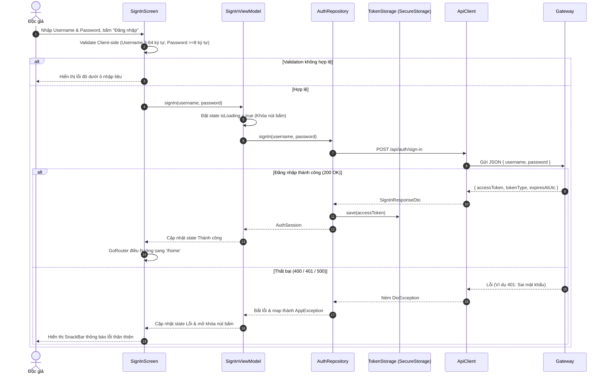
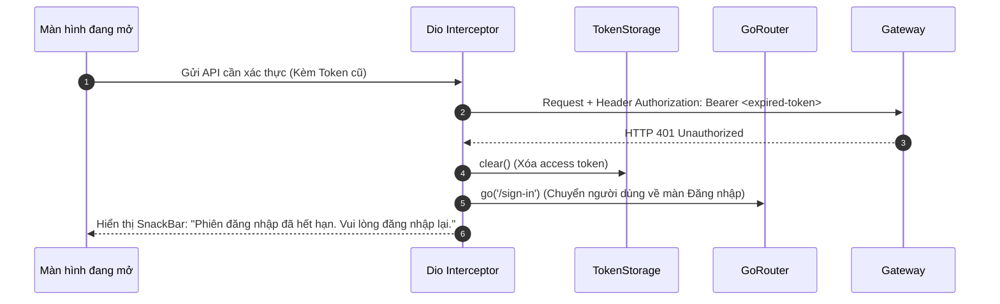
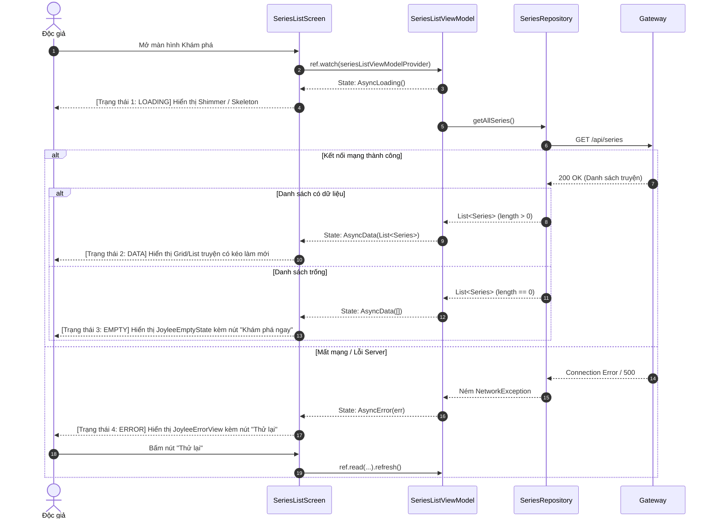
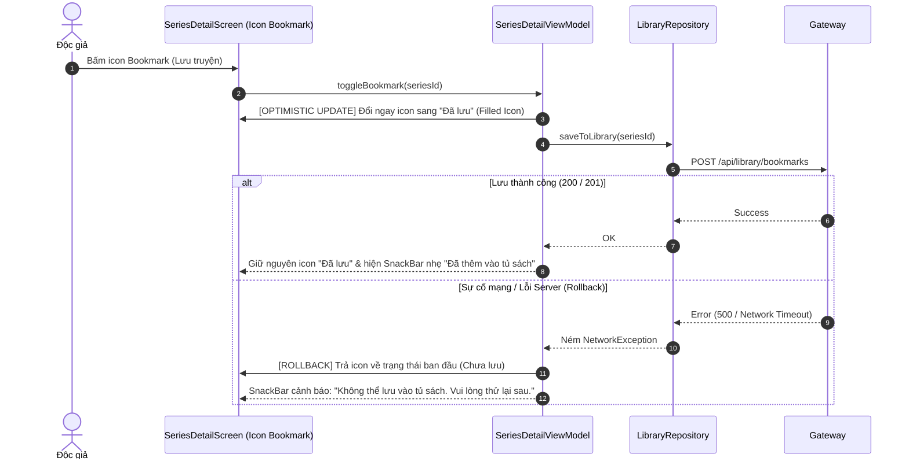

# JoyleeBook Mobile — Luồng Nghiệp vụ & Hợp đồng API (Flows & API Contracts)

Tài liệu này mô tả chi tiết các luồng tương tác của **Độc giả (Reader)** trên ứng dụng di động, kết hợp với bảng đặc tả hợp đồng dữ liệu (API Contracts) qua **JoyleeBook API Gateway** (`https://api.joyleebook.duckdns.org`).

---

## 1. Luồng Xác thực & Quản lý Phiên (Authentication & Session Lifecycle)

Luồng xác thực đảm bảo bảo vệ dữ liệu cá nhân của độc giả, duy trì phiên an toàn và xử lý chuyển tiếp mượt mà khi phiên làm việc hết hạn.

### 1.1. Sơ đồ tuần tự Đăng nhập (Sign In Flow)



### 1.2. Sơ đồ xử lý Token hết hạn (401 Unauthorized Interceptor Flow)

Khi phiên đăng nhập của người dùng hết hạn trong lúc đang sử dụng app:



> [!IMPORTANT]
> **Quy tắc Single-Notification cho 401:**
> Interceptor sử dụng cơ chế cờ (`_isSessionExpiredHandled`) để nếu nhiều request ngầm đồng thời nhận mã 401, hệ thống **chỉ hiển thị 1 thông báo duy nhất** và chỉ thực hiện 1 lần chuyển trang về `/sign-in`.

---

## 2. Luồng Khám phá Truyện & Tìm kiếm (Series Discovery Flow)

Độc giả duyệt danh mục tác phẩm và tìm kiếm truyện theo từ khóa.

### 2.1. Sơ đồ tải danh sách & Xử lý 4 trạng thái (4 States Pattern)



### 2.2. Cơ chế Debounce Tìm kiếm truyện (Search Debounce)

Để tránh spam server khi người dùng gõ từng ký tự vào ô tìm kiếm:
1. Khi độc giả nhập từ khóa: Hủy bỏ timer tìm kiếm cũ.
2. Khởi tạo một `Timer` đếm ngược **400ms**.
3. Nếu người dùng tiếp tục gõ trước khi hết 400ms: Bộ đếm được reset lại từ đầu.
4. Khi người dùng ngừng gõ đủ 400ms: Bắn request gọi API tìm kiếm `GET /api/series?q={query}`.

---

## 3. Luồng Tủ Sách & Yêu thích (Library Flow with Optimistic UI)

Khi độc giả bấm lưu truyện vào Tủ sách cá nhân (Bookmark), ứng dụng phản hồi lập tức để tạo cảm giác mượt mà, nhưng vẫn đảm bảo tính toàn vẹn dữ liệu nếu gặp lỗi mạng.



---

## 4. Luồng Đọc Truyện & Ghi nhớ Tiến độ Offline (Reading Flow)

1. **Mở chương đọc**: Độc giả chọn chương từ danh mục -> App mở `ChapterReadingScreen`.
2. **Hiển thị nội dung**: Áp dụng giao diện đọc Warm Editorial (chữ mực trên nền giấy ngà dịu mắt, tùy chỉnh cỡ chữ).
3. **Tự động lưu tiến độ**:
   - Khi độc giả cuộn màn hình hoặc thoát khỏi chương: App ghi nhận `seriesId`, `chapterId`, `scrollOffset` vào `SharedPreferences` / SQLite.
4. **Tiếp tục đọc (Resume Reading)**:
   - Khi độc giả mở lại chi tiết bộ truyện hoặc trang chủ, ứng dụng hiển thị nút **"Đọc tiếp chương X"**, bấm vào sẽ mở đúng vị trí đọc dở gần nhất mà không cần tải lại toàn bộ từ mạng.

---

## 5. Bảng Đặc tả Hợp đồng API (API Contracts qua Gateway)

Tất cả các lệnh gọi API đều đi qua JoyleeBook API Gateway tại địa chỉ base: `https://api.joyleebook.duckdns.org` (Swagger: `https://api.joyleebook.duckdns.org/docs/authentication/swagger/index.html`, `https://api.joyleebook.duckdns.org/docs/series/swagger/index.html`).

### 5.1. Nhóm API Xác thực (Authentication)

#### 1. Đăng nhập (`POST /api/auth/sign-in`)
- **Quyền truy cập**: Public.
- **Request Body**:
  ```json
  {
    "username": "reader_demo",
    "password": "Password123"
  }
  ```
- **Response thành công (`200 OK`)**:
  ```json
  {
    "accessToken": "eyJhbGciOi...",
    "tokenType": "Bearer",
    "expiresAtUtc": "2026-10-15T08:30:00Z"
  }
  ```
- **Response lỗi**:
  - `400 Bad Request`: Thông tin đăng nhập không hợp lệ hoặc thiếu trường.
  - `401 Unauthorized`: Sai tên đăng nhập hoặc mật khẩu.

#### 2. Đăng ký tài khoản độc giả (`POST /api/auth/sign-up`)
- **Quyền truy cập**: Public.
- **Giới hạn tốc độ (Rate Limit)**: Tối đa 30 request/phút.
- **Request Body**:
  ```json
  {
    "username": "reader_new",
    "email": "reader@example.com",
    "password": "Password123"
  }
  ```
- **Response thành công (`200 OK` hoặc `201 Created`)**:
  ```json
  {
    "message": "Đăng ký tài khoản thành công"
  }
  ```
- **Response lỗi**:
  - `409 Conflict`: Tên đăng nhập hoặc email đã tồn tại trên hệ thống.
  - `429 Too Many Requests`: Gửi yêu cầu quá nhanh, app hiển thị thông báo chờ.

#### 3. Đăng xuất (`POST /api/auth/sign-out`)
- **Quyền truy cập**: Bearer Token.
- **Headers**: `Authorization: Bearer <accessToken>`
- **Response thành công (`200 OK` hoặc `204 No Content`)**: Token bị thu hồi trên backend; Mobile luôn xóa token cục bộ.

---

### 5.2. Nhóm API Tác phẩm (Series)

#### 1. Lấy danh sách truyện (`GET /api/series`)
- **Quyền truy cập**: Public (Độc giả thông thường chỉ thấy các truyện đã xuất bản).
- **Query params (nếu có)**: `?page=1&pageSize=20&search=keyword`
- **Response thành công (`200 OK`)**:
  ```json
  [
    {
      "id": 1,
      "title": "Hành Trình Về Phương Đông",
      "authorId": 102,
      "authorName": "Nguyên Phong",
      "description": "Tác phẩm kinh điển về tâm linh và văn hóa phương Đông...",
      "coverUrl": "https://cdn.joyleebook.com/covers/htvpd.jpg",
      "status": 0,
      "totalChapters": 25,
      "createdAt": "2026-09-01T00:00:00Z"
    }
  ]
  ```
  *(Lưu ý: Enum `status`: `0` = Hoàn thành / Completed, `1` = Đang tiến hành / Ongoing).*

#### 2. Lấy chi tiết truyện (`GET /api/series/{id}`)
- **Quyền truy cập**: Public.
- **Response thành công (`200 OK`)**: Trả về thông tin đầy đủ của truyện kèm danh sách tóm tắt các chương.
- **Response lỗi**: `404 Not Found` (Truyện không tồn tại hoặc đã bị ẩn).

---

### 5.3. Base URL của Gateway

Dự án dùng chung một Gateway đã deploy qua HTTPS, không chạy backend local. `lib/config/environment.dart` mặc định trỏ tới `https://api.joyleebook.duckdns.org`, nên mọi emulator, simulator và thiết bị thật đều chạy cùng một lệnh:

```bash
flutter run -t lib/main_development.dart
```

Chỉ truyền `--dart-define=API_BASE_URL=https://<gateway-khac>` khi cần trỏ sang Gateway khác. Giá trị này là gốc của Gateway, không kèm `/api/...`.
