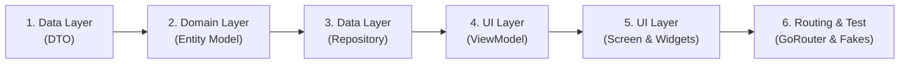

# JoyleeBook Mobile — Hướng dẫn Thiết kế Chức năng Mẫu (Feature Implementation Guide)

Tài liệu này là bản hướng dẫn từng bước (**Step-by-step Template & Blueprint**) để thiết kế và hiện thực hóa một chức năng hoàn chỉnh trên **JoyleeBook Mobile**, tuân thủ 100% các tiêu chuẩn kiến trúc, giao diện Warm Editorial và quy tắc lập trình đã quy định.

Chức năng mẫu được chọn để hướng dẫn: **Tính năng Khám phá Truyện (Series Discovery)** dành riêng cho **Actor Reader** — bao gồm: tải danh sách truyện, tìm kiếm có debounce, xử lý trọn vẹn 4 trạng thái giao diện, và đánh dấu yêu thích với cơ chế Optimistic UI.

---

## Tổng quan 6 Bước Triển khai Chuẩn mực



---

## Bước 1: Tầng Data — Định nghĩa DTO (`lib/data/dtos/series_dto.dart`)

DTO (Data Transfer Object) ánh xạ chính xác cấu trúc JSON trả về từ JoyleeBook Gateway (`GET /api/series`), xử lý null safety và chuyển đổi kiểu dữ liệu.

```dart
import 'package:flutter/foundation.dart';

@immutable
class SeriesDto {
  const SeriesDto({
    required this.id,
    required this.title,
    required this.authorId,
    required this.authorName,
    this.description,
    this.coverUrl,
    required this.status,
    required this.totalChapters,
  });

  final int id;
  final String title;
  final int authorId;
  final String authorName;
  final String? description;
  final String? coverUrl;
  final int status; // 0: Completed, 1: Ongoing
  final int totalChapters;

  factory SeriesDto.fromJson(Map<String, dynamic> json) {
    return SeriesDto(
      id: json['id'] as int,
      title: json['title'] as String? ?? 'Chưa có tiêu đề',
      authorId: json['authorId'] as int? ?? 0,
      authorName: json['authorName'] as String? ?? 'Khuyết danh',
      description: json['description'] as String?,
      coverUrl: json['coverUrl'] as String?,
      status: json['status'] as int? ?? 1,
      totalChapters: json['totalChapters'] as int? ?? 0,
    );
  }

  Map<String, dynamic> toJson() {
    return {
      'id': id,
      'title': title,
      'authorId': authorId,
      'authorName': authorName,
      'description': description,
      'coverUrl': coverUrl,
      'status': status,
      'totalChapters': totalChapters,
    };
  }
}
```

> [!NOTE]
> Có thể sử dụng thư viện `json_serializable` với annotation `@JsonSerializable()` và chạy `dart run build_runner build` để tự động sinh code `_$SeriesDtoFromJson`.

---

## Bước 2: Tầng Domain — Định nghĩa Pure Domain Model (`lib/domain/models/series.dart`)

Domain Model là đối tượng nghiệp vụ thuần túy (Pure Dart). Tuyệt đối **không import** `flutter/material.dart` hay các thư viện hạ tầng vào đây.

```dart
import 'package:flutter/foundation.dart';
import '../../data/dtos/series_dto.dart';

enum SeriesStatus {
  completed,
  ongoing;

  static SeriesStatus fromInt(int value) =>
      value == 0 ? SeriesStatus.completed : SeriesStatus.ongoing;

  String get label => switch (this) {
        SeriesStatus.completed => 'Hoàn thành',
        SeriesStatus.ongoing => 'Đang tiến hành',
      };
}

@immutable
class Series {
  const Series({
    required this.id,
    required this.title,
    required this.authorName,
    required this.description,
    required this.coverUrl,
    required this.status,
    required this.totalChapters,
    this.isBookmarked = false,
  });

  final int id;
  final String title;
  final String authorName;
  final String description;
  final String coverUrl;
  final SeriesStatus status;
  final int totalChapters;
  final bool isBookmarked;

  /// Chuyển đổi an toàn từ DTO sang Domain Model
  factory Series.fromDto(SeriesDto dto, {bool isBookmarked = false}) {
    return Series(
      id: dto.id,
      title: dto.title,
      authorName: dto.authorName,
      description: dto.description ?? 'Chưa có mô tả tác phẩm.',
      coverUrl: dto.coverUrl ?? '',
      status: SeriesStatus.fromInt(dto.status),
      totalChapters: dto.totalChapters,
      isBookmarked: isBookmarked,
    );
  }

  Series copyWith({
    bool? isBookmarked,
  }) {
    return Series(
      id: id,
      title: title,
      authorName: authorName,
      description: description,
      coverUrl: coverUrl,
      status: status,
      totalChapters: totalChapters,
      isBookmarked: isBookmarked ?? this.isBookmarked,
    );
  }

  @override
  bool operator ==(Object other) =>
      identical(this, other) ||
      other is Series && runtimeType == other.runtimeType && id == other.id;

  @override
  int get hashCode => id.hashCode;
}
```

---

## Bước 3: Tầng Data — Xây dựng Repository (`lib/data/repositories/series_repository.dart`)

Repository gọi API qua `Dio`, bắt các lỗi mạng để bọc thành `AppException`, và ánh xạ DTO sang Domain Model.

```dart
import 'package:dio/dio.dart';
import 'package:flutter_riverpod/flutter_riverpod.dart';
import '../../domain/models/series.dart';
import '../dtos/series_dto.dart';
import '../services/api_client.dart';
import '../services/api_exceptions.dart';

class SeriesRepository {
  SeriesRepository(this._dio);
  final Dio _dio;

  /// Lấy danh sách truyện từ JoyleeBook Gateway
  Future<List<Series>> getSeriesList({String? searchQuery}) async {
    try {
      final queryParams = <String, dynamic>{};
      if (searchQuery != null && searchQuery.trim().isNotEmpty) {
        queryParams['search'] = searchQuery.trim();
      }

      final response = await _dio.get<List<dynamic>>(
        '/api/series',
        queryParameters: queryParams,
      );

      final dtos = (response.data ?? [])
          .cast<Map<String, dynamic>>()
          .map(SeriesDto.fromJson);

      return dtos.map(Series.fromDto).toList(growable: false);
    } on DioException catch (e) {
      throw AppException.fromDio(e);
    } catch (e) {
      throw AppException(message: 'Không thể xử lý dữ liệu danh sách truyện.');
    }
  }

  /// Cập nhật bookmark truyện vào tủ sách
  Future<void> toggleBookmark(int seriesId, bool shouldBookmark) async {
    try {
      if (shouldBookmark) {
        await _dio.post<void>('/api/library/bookmarks', data: {'seriesId': seriesId});
      } else {
        await _dio.delete<void>('/api/library/bookmarks/$seriesId');
      }
    } on DioException catch (e) {
      throw AppException.fromDio(e);
    }
  }
}

// Provider DI qua Riverpod
final seriesRepositoryProvider = Provider<SeriesRepository>((ref) {
  final dio = ref.watch(apiClientProvider);
  return SeriesRepository(dio);
});
```

---

## Bước 4: Tầng UI — Xây dựng ViewModel (`lib/ui/series/view_models/series_list_view_model.dart`)

ViewModel kế thừa `AsyncNotifier<List<Series>>`, quản lý state của màn hình và thực hiện nghiệp vụ:
- Gọi dữ liệu ban đầu.
- Làm mới dữ liệu (`refresh()`).
- Tìm kiếm có Debounce 400ms.
- **Optimistic UI with Rollback** khi người dùng Bookmark truyện.

```dart
import 'dart:async';
import 'package:flutter_riverpod/flutter_riverpod.dart';
import '../../../data/repositories/series_repository.dart';
import '../../../domain/models/series.dart';

final seriesListViewModelProvider =
    AsyncNotifierProvider<SeriesListViewModel, List<Series>>(
  SeriesListViewModel.new,
);

class SeriesListViewModel extends AsyncNotifier<List<Series>> {
  Timer? _debounceTimer;

  @override
  Future<List<Series>> build() {
    return ref.watch(seriesRepositoryProvider).getSeriesList();
  }

  /// Kéo để làm mới trang (Pull-to-refresh)
  Future<void> refresh() async {
    state = const AsyncLoading();
    state = await AsyncValue.guard(
      () => ref.read(seriesRepositoryProvider).getSeriesList(),
    );
  }

  /// Tìm kiếm truyện có Debounce 400ms chống spam request
  void search(String query) {
    _debounceTimer?.cancel();
    _debounceTimer = Timer(const Duration(milliseconds: 400), () async {
      state = const AsyncLoading();
      state = await AsyncValue.guard(
        () => ref.read(seriesRepositoryProvider).getSeriesList(searchQuery: query),
      );
    });
  }

  /// Optimistic UI: Đổi trạng thái Bookmark ngay lập tức, rollback nếu API lỗi
  Future<bool> toggleBookmark(int seriesId) async {
    final currentList = state.valueOrNull;
    if (currentList == null) return false;

    final targetIndex = currentList.indexWhere((s) => s.id == seriesId);
    if (targetIndex == -1) return false;

    final originalItem = currentList[targetIndex];
    final newBookmarkState = !originalItem.isBookmarked;

    // 1. Cập nhật lạc quan (Optimistic Update)
    final updatedList = List<Series>.from(currentList);
    updatedList[targetIndex] = originalItem.copyWith(isBookmarked: newBookmarkState);
    state = AsyncData(updatedList);

    // 2. Bắn request ngầm lên Gateway
    try {
      await ref.read(seriesRepositoryProvider).toggleBookmark(seriesId, newBookmarkState);
      return true;
    } catch (_) {
      // 3. Rollback nếu có lỗi mạng/server
      final rollbackList = List<Series>.from(state.valueOrNull ?? currentList);
      rollbackList[targetIndex] = originalItem;
      state = AsyncData(rollbackList);
      return false; // Báo về cho UI hiển thị SnackBar cảnh báo
    }
  }
}
```

---

## Bước 5: Tầng UI — Xây dựng Màn hình Chuẩn 4 Trạng thái (`lib/ui/series/widgets/series_list_screen.dart`)

Màn hình áp dụng Material 3, bảng màu Warm Editorial (`context.colors`), touch target >= 48x48dp, và xử lý đầy đủ **Bộ 4 trạng thái bắt buộc**:

```dart
import 'package:flutter/material.dart';
import 'package:flutter_riverpod/flutter_riverpod.dart';
import 'package:go_router/go_router.dart';
import '../../core/themes/app_colors.dart';
import '../../core/themes/app_dimensions.dart';
import '../../core/widgets/joylee_empty_state.dart';
import '../../core/widgets/joylee_error_view.dart';
import '../view_models/series_list_view_model.dart';
import 'series_card.dart';

class SeriesListScreen extends ConsumerStatefulWidget {
  const SeriesListScreen({super.key});

  @override
  ConsumerState<SeriesListScreen> createState() => _SeriesListScreenState();
}

class _SeriesListScreenState extends ConsumerState<SeriesListScreen> {
  final TextEditingController _searchController = TextEditingController();

  @override
  void dispose() {
    _searchController.dispose();
    super.dispose();
  }

  @override
  Widget build(BuildContext context) {
    final colors = context.colors;
    final seriesState = ref.watch(seriesListViewModelProvider);

    return Scaffold(
      appBar: AppBar(
        title: Text(
          'Kho Truyện JoyleeBook',
          style: TextStyle(
            color: colors.textPrimary,
            fontWeight: FontWeight.bold,
            fontSize: 20,
          ),
        ),
        bottom: PreferredSize(
          preferredSize: const Size.fromHeight(60),
          child: Padding(
            padding: const EdgeInsets.symmetric(
              horizontal: AppDimensions.space4,
              vertical: AppDimensions.space2,
            ),
            child: TextField(
              controller: _searchController,
              onChanged: (val) =>
                  ref.read(seriesListViewModelProvider.notifier).search(val),
              decoration: InputDecoration(
                hintText: 'Tìm kiếm tựa truyện, tác giả...',
                prefixIcon: Icon(Icons.search, color: colors.textSecondary),
                suffixIcon: _searchController.text.isNotEmpty
                    ? IconButton(
                        icon: const Icon(Icons.clear),
                        onPressed: () {
                          _searchController.clear();
                          ref.read(seriesListViewModelProvider.notifier).search('');
                        },
                      )
                    : null,
                filled: true,
                fillColor: colors.bgSurface,
                contentPadding: const EdgeInsets.symmetric(
                  horizontal: AppDimensions.space4,
                  vertical: AppDimensions.space3,
                ),
                border: OutlineInputBorder(
                  borderRadius: BorderRadius.circular(AppDimensions.radiusFull),
                  borderSide: BorderSide(color: colors.borderDefault),
                ),
              ),
            ),
          ),
        ),
      ),
      body: seriesState.when(
        // TRẠNG THÁI 1: LOADING (Spinner hoặc Shimmer)
        loading: () => Center(
          child: CircularProgressIndicator(
            valueColor: AlwaysStoppedAnimation<Color>(colors.primaryBrand),
          ),
        ),

        // TRẠNG THÁI 2: ERROR (Thông báo thân thiện kèm nút Retry)
        error: (err, stack) => JoyleeErrorView(
          message: err.toString(),
          onRetry: () =>
              ref.read(seriesListViewModelProvider.notifier).refresh(),
        ),

        // TRẠNG THÁI 3 & 4: DATA HOẶC EMPTY
        data: (seriesList) {
          if (seriesList.isEmpty) {
            return JoyleeEmptyState(
              title: 'Không tìm thấy truyện nào',
              message: 'Hãy thử tìm từ khóa khác hoặc làm mới lại danh mục.',
              actionLabel: 'Tải lại danh sách',
              onAction: () {
                _searchController.clear();
                ref.read(seriesListViewModelProvider.notifier).refresh();
              },
            );
          }

          return RefreshIndicator(
            color: colors.primaryBrand,
            backgroundColor: colors.bgSurface,
            onRefresh: () =>
                ref.read(seriesListViewModelProvider.notifier).refresh(),
            child: ListView.builder(
              padding: const EdgeInsets.all(AppDimensions.space4),
              itemCount: seriesList.length,
              itemBuilder: (context, index) {
                final item = seriesList[index];
                return SeriesCard(
                  series: item,
                  onTap: () => context.push('/series/${item.id}'),
                  onBookmarkTap: () async {
                    final success = await ref
                        .read(seriesListViewModelProvider.notifier)
                        .toggleBookmark(item.id);
                    if (!success && context.mounted) {
                      ScaffoldMessenger.of(context).showSnackBar(
                        SnackBar(
                          content: const Text(
                            'Không thể cập nhật tủ sách. Vui lòng thử lại sau.',
                          ),
                          backgroundColor: colors.danger,
                        ),
                      );
                    }
                  },
                );
              },
            ),
          );
        },
      ),
    );
  }
}
```

---

## Bước 6: Đăng ký Route & Viết Unit / Widget Test

### 6.1. Đăng ký Route trong `lib/routing/app_router.dart`
```dart
GoRoute(
  path: '/home',
  builder: (context, state) => const SeriesListScreen(),
),
GoRoute(
  path: '/series/:id',
  builder: (context, state) {
    final seriesId = int.parse(state.pathParameters['id']!);
    return SeriesDetailScreen(seriesId: seriesId);
  },
),
```

### 6.2. Tạo Mock/Fake Repository (`testing/fakes/fake_series_repository.dart`)
Tạo repository giả để chạy kiểm thử tự động độc lập với máy chủ:

```dart
import '../../lib/data/repositories/series_repository.dart';
import '../../lib/domain/models/series.dart';

class FakeSeriesRepository implements SeriesRepository {
  FakeSeriesRepository([this.mockList = const []]);
  final List<Series> mockList;

  @override
  Future<List<Series>> getSeriesList({String? searchQuery}) async {
    if (searchQuery != null && searchQuery.isNotEmpty) {
      return mockList.where((s) => s.title.contains(searchQuery)).toList();
    }
    return mockList;
  }

  @override
  Future<void> toggleBookmark(int seriesId, bool shouldBookmark) async {}
}
```

### 6.3. Viết Widget Test kiểm tra trạng thái (`test/ui/series_list_screen_test.dart`)
Ghi đè provider trong bài test:

```dart
testWidgets('Hiển thị JoyleeEmptyState khi danh sách truyện rỗng', (tester) async {
  await tester.pumpWidget(
    ProviderScope(
      overrides: [
        seriesRepositoryProvider.overrideWithValue(FakeSeriesRepository([])),
      ],
      child: const MaterialApp(home: SeriesListScreen()),
    ),
  );

  await tester.pumpAndSettle();
  expect(find.byType(JoyleeEmptyState), findsOneWidget);
  expect(find.text('Không tìm thấy truyện nào'), findsOneWidget);
});
```

---

## Bảng Đối chiếu Tiêu chuẩn Chất lượng của Chức năng Mẫu

| Hạng mục kiểm tra | Đã đáp ứng | Cơ chế kiểm soát |
| :--- | :---: | :--- |
| **Compass App Hybrid Architecture** | ✅ | Tách biệt `data/dtos`, `domain/models`, `data/repositories`, `ui/series/view_models` và `ui/series/widgets`. |
| **Material 3 & Warm Editorial** | ✅ | Màu Plum (`primaryBrand`), nền Canvas ngà, Surface thẻ truyện bo góc `radiusMd`. |
| **Bộ 4 Trạng thái (4 States)** | ✅ | Đủ Loading Shimmer, Empty State, Error View có Retry, Data ListView. |
| **Touch Target & No Overflow** | ✅ | Thẻ truyện và icon bấm được đạt tối thiểu 48x48dp, danh sách cuộn `ListView.builder`. |
| **Debounce Tìm kiếm** | ✅ | Trì hoãn 400ms sau khi ngừng gõ mới bắn request lên API Gateway. |
| **Optimistic UI with Rollback** | ✅ | Cập nhật icon Bookmark ngay lập tức, tự phục hồi trạng thái cũ nếu API báo lỗi. |
| **Kiểm thử độc lập với Fake Provider**| ✅ | Cho phép override `seriesRepositoryProvider` bằng `FakeSeriesRepository`. |
